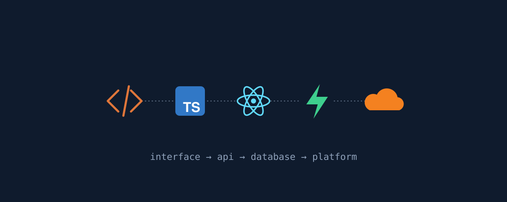

# Hi 👋, I'm Angel Royce Lopez

A full-stack developer from the Philippines. I build fast, accessible web apps end to end — the interface, the API, the database and the platform it runs on.

- 🔭 I'm a **Full-Stack Developer** who has shipped 10+ projects to production, including care-service platforms for families and pharmacies in Germany
- 🎓 I graduated with a BS in Information Technology from **Our Lady of Fatima University**, Pampanga (2021–2025), and served as President of the College of Computer Studies (2023–2024)
- 🌐 Portfolio: **[arpl-portfolio.vercel.app](https://arpl-portfolio.vercel.app)**
- 📫 How to reach me: **[lopezroyce041@gmail.com](mailto:lopezroyce041@gmail.com)**
- 💼 Open to new roles

## 🛠️ Tech I use

**Daily:** TypeScript · Astro · Next.js & React · Supabase / PostgreSQL · Cloudflare Workers · PHP 8 · Tailwind CSS

**Comfortable with:** Stripe · Docker · Playwright · Zoho Creator & Deluge · n8n · WordPress · Laravel · Hono · D1 · Drizzle

**Tracking & marketing:** Google Tag Manager · GA4 · Google Ads · Meta Ads · Google Search Console · Consent Mode v2

  

  
  
  
  
  

## 🚀 Selected work

| Project | What it is |
|---|---|
| [Digitaler Pflegeantrag](https://digitaler-pflegeantrag.de/antrag/) | The care-grade application form families in Germany use. I built v4 in PHP, then rewrote it as v5 on Cloudflare Workers — v5 won its A/B test and now serves all landing-page traffic. |
| Pharmacy Portal | Pharmacies and care companies apply for ~10 care services on behalf of patients, with digital signatures, postal-code pricing and Supabase RLS synced to Zoho Creator. Also shipped as white-label portals for ARZ Care and Noventi. |
| Partner Portal v2 | A rebuild of the pharmacy portal on Astro and Cloudflare Workers, running on the company's central Supabase database. |
| [EnkianCare](https://enkiancare.de) | Contributed to the guidance site, built the MDK assessment prep course (Next.js, Supabase, Stripe), and worked on the add-on shop: Astro + React on a Cloudflare Worker with Stripe Embedded Checkout. |
| CareUp | An 8-week certified prevention course for family caregivers, built on Next.js 14 and Supabase (EU). |
| [PflegeKursPlus](https://pflegekursplus.de) | E-learning for caregivers on WordPress + TutorLMS: video progress tracking, quizzes that unlock as you watch, and automatic certificates. |
| Field Capture + A/B Dashboard | An invisible field-level tracker, a validating Cloudflare Worker, and a React dashboard showing conversion and drop-off per step and field. |
| Cookie Consent Tool | A framework-agnostic GDPR consent module driving Google Consent Mode v2 for GA4, Google Ads and Meta, with every decision audit-logged. |

## 💼 Experience

**Software Developer** — Perulatus GmbH
- Built the digital care application form solo: v4 in PHP, then v5 on Cloudflare Workers, which won its A/B test and took over all landing-page traffic
- Built the Pharmacy Portal (PHP 8, Supabase, Zoho Creator) and white-label portals for ARZ Care and Noventi
- Worked across the EnkianCare platform: contributed to the guidance site, built the MDK assessment prep course, and set up the shop's Cloudflare Workers environment and Stripe integration
- Built field-level form analytics: an invisible tracker, a validating Worker, drop-off views in Supabase and an A/B testing dashboard
- Handled tracking across the company's sites: Google Tag Manager containers, GA4, Google Ads and Meta Ads conversion events, Consent Mode v2, and Google Search Console
- Built CareUp, a certified prevention course for family caregivers, and the Partner Portal v2 on Cloudflare Workers
- Wrote Zoho Creator / Deluge workflows that sync portal applications into Zoho CRM, and documented projects to the company's documentation standard

**Software Developer Intern** — DOST (Department of Science & Technology)
- Developed a ticketing system for employee device requests, integrated with the existing inventory system
- Monitored system activity via Cloudflare, identifying suspicious IPs and writing security reports

## 🤝 Connect with me

